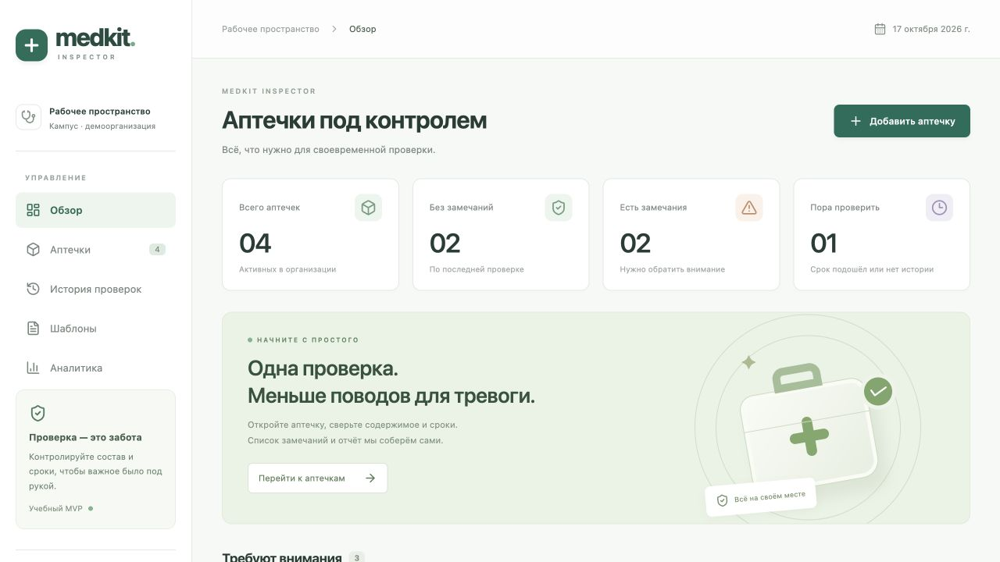
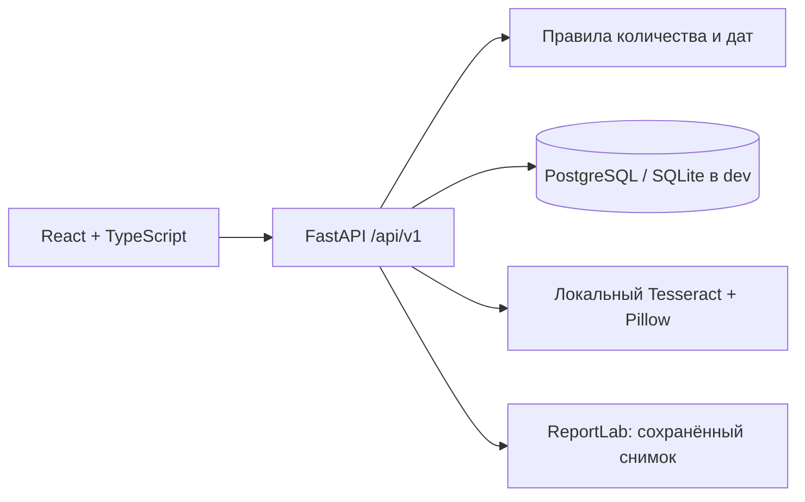

# MedKit Inspector

Веб-приложение для инвентарной проверки аптечек: QR → чек-лист → количество и группы сроков → результат → история и PDF.

Реализовано по двум предоставленным документам от 3 октября 2026 года. Это работающий учебный MVP. Полная приёмка по всем P0 из SRS ещё не завершена: точность OCR, удобство с реальными пользователями, нагрузка, мобильная камера и эксплуатационные показатели требуют отдельных испытаний. Статусы и ограничения описаны в [матрице требований](docs/requirements.md).



## Текущий локальный стенд

Приложение уже запущено на **http://127.0.0.1:8010** (SQLite + локальный Tesseract). Для повторного запуска после остановки выполните `bash scripts/dev.sh`. PostgreSQL/Docker проверен отдельно; ограничение проброса портов текущего Colima описано в [протоколе](docs/verification.md).

## Быстрый запуск с Docker

Нужны Docker и Docker Compose. Команда `scripts/compose.sh` поддерживает и `docker compose`, и `docker-compose`.

```bash
cp .env.example .env
# Замените POSTGRES_PASSWORD в .env длинным случайным паролем из букв/цифр.
bash scripts/compose.sh up -d --build
bash scripts/compose.sh exec app python -m app.cli seed-demo
```

Открыть **http://localhost:8010**. Документация API: **http://localhost:8010/docs**.

| Роль | Почта | Учебный пароль |
|---|---|---|
| Админ | admin@medkit.demo | MedkitDemo2026! |
| Инспектор | inspector@medkit.demo | MedkitDemo2026! |

`seed-demo` вызывается явно, повторный запуск не дублирует данные. Демоаккаунты предназначены для учебного стенда. Для настоящих аккаунтов используйте CLI ниже.

Демонстрационные аптечки: Главный корпус (недостача, просрочка и неизвестный срок), Лаборатория (без замечаний), Спортивный зал (просроченный обход), Библиотека (без истории). Даты рассчитываются относительно момента наполнения. Учебный состав не является нормативным.

## Локально без Docker

Python **3.12**, Node.js **22+**, npm. Для OCR нужен Tesseract в PATH (`brew install tesseract` на macOS). Для PDF нужен DejaVu Sans на Linux или Arial из системных шрифтов macOS. Docker включает OCR и шрифты.

```bash
bash scripts/dev.sh
```

Скрипт создаёт `.venv`, устанавливает зависимости, собирает React, создаёт SQLite `medkit.db`, наполняет демо и запускает сервер на http://localhost:8010. Без установленного Tesseract ручной сценарий работает, OCR предлагает ручной ввод с сообщением `OCR_UNAVAILABLE`.

При работе над интерфейсом:

```bash
# Терминал 1
PYTHONPATH=backend .venv/bin/uvicorn app.main:app --port 8010 --reload --no-access-log
# Терминал 2
npm run dev --prefix frontend
```

Vite открывается на http://localhost:5173 и проксирует API. Для QR в dev задайте `BASE_URL=http://localhost:5173` перед запуском API. Docker и локальный сервер одновременно на одном порту не запускайте.

## Что работает

- Вход/выход, роли ADMIN/INSPECTOR, изоляция организаций, серверные сессии и CSRF.
- Создание, изменение, архивирование аптечек; QR с постоянным случайным кодом.
- Создание шаблонов и новых версий, 1–50 позиций, явная единица учёта.
- Один черновик на аптечку, возобновление, проверка revision, отмена с причиной.
- Ручной подсчёт и 1–20 групп сроков на позицию; UNKNOWN с причиной.
- Даты DD.MM.YYYY, YYYY-MM-DD, MM/YYYY; отдельное подтверждение последнего дня месяца.
- Локальный OCR JPEG/PNG на Tesseract, предложение даты без изменения инспекции.
- Атомарное завершение, независимые причины проблем, расчёт пополнения без двойного счёта.
- Неизменяемые снимки, история по 20 записей, PDF на русском языке.
- Отдельные признаки последнего результата, срока обхода, изменений шаблона и новых просрочек.
- Обзор, поиск/фильтры аптечек, аналитика текущих результатов и план обхода.

Система учитывает количество и даты; она не оценивает медицинскую пригодность. Результат относится к дате проверки; расход после неё не отслеживается.

## Архитектура



`backend/app/rules.py` содержит чистые бизнес-правила; `main.py` — REST API, транзакции и контроль доступа; `db.py` — реляционные модели. Реквизиты, позиции, группы и расчёты инспекции хранятся в JSON-снимках: завершённые записи не зависят от актуальных справочников. Используется один процесс API: лимиты входа и OCR пока хранятся в памяти процесса.

В PostgreSQL и SQLite частичный уникальный индекс запрещает два DRAFT одной аптечки. Изменения черновика используют атомарный UPDATE по revision и lifecycle. PostgreSQL дополнительно блокирует строки при изменении справочников/стартe инспекции. Завершение записывает факты и результат одной транзакцией, повторное завершение возвращает существующий снимок.

Начальная схема v1 создаётся идемпотентно через `init-db`/при старте. Это начальная миграция пустой БД, не механизм обновления будущих схем. До следующего изменения структуры следует добавить Alembic и проверку версии миграций.

## Аккаунты через CLI

В Docker команды имеют префикс `bash scripts/compose.sh exec app`. Локально — `PYTHONPATH=backend .venv/bin/python` вместо `python`.

```bash
python -m app.cli init-db
python -m app.cli create-org --name "Учебный корпус" --timezone Europe/Moscow
python -m app.cli create-user --org-id 1 --email admin@example.org --name "Администратор" --role ADMIN
python -m app.cli create-user --org-id 1 --email inspector@example.org --name "Инспектор" --role INSPECTOR
python -m app.cli reset-password --email inspector@example.org
python -m app.cli disable-user --email inspector@example.org
```

`create-org` выводит ID; подставьте его в `--org-id`. Пароль вводится скрыто, 12–128 символов, в аргументы команд не попадает. При сбросе/отключении прежние сессии удаляются. Часовой пояс IANA фиксируется при создании организации.

## Проверки

```bash
.venv/bin/pip install -r backend/requirements-dev.txt
npm ci --prefix frontend
make test
make check
make build
.venv/bin/pip-audit
npm audit --prefix frontend
```

Зависимости приложения закреплены в `requirements.txt`, транзитивные версии — в `constraints.txt`, клиентские — в `package-lock.json`. Для обновления меняйте версии и ограничения согласованно. `constraints.txt` также содержит версии инструментов разработки, но Docker устанавливает только зависимости из production requirements.

Тесты: DS-RULES-1 (12 эталонов), валидность дат, границы суток/часовой пояс, UNKNOWN, подтверждения, роли и чужие организации, CSRF/сессии, конфликты revision, атомарность, повторное завершение, стабильность снимка, PDF, загрузки и TRACE на 100 инспекциях. Тесты используют отдельные SQLite-базы и не подключаются к пользовательской БД.

CI запускает lint, типы, тесты, сборку React и Docker. Запрет слияния с падающими проверками нужно включить в настройках GitHub branch protection; локальный YAML сам не включает это правило. CI не публикует сервис автоматически.

## Ограничения и сопровождение

- [Анализ требований и трассировка](docs/requirements.md).
- [Продуктовый анализ и план проверки гипотез](docs/analysis.md).
- [Развёртывание, backup/restore, откат](docs/operations.md).
- [Протокол проверок](docs/verification.md).

OCR имеет ограничения 5 MiB, 12 MP, 10 запросов/минуту на пользователя, 1 выполняемый + 2 ожидающих запроса на процесс. Время Tesseract ограничено 12 секундами; время декодирования/очереди отдельно не включено в жёсткий общий deadline — это известный зазор относительно SRS. Фото и полный текст не записываются приложением в БД/логи; UploadFile закрывается после чтения. Загрузки >1 MiB могут временно попадать в системный spool; для пилота используйте tmpfs и лимит тела на прокси. Для Windows PDF-шрифты требуют отдельной настройки; целевая среда Docker/Linux.
